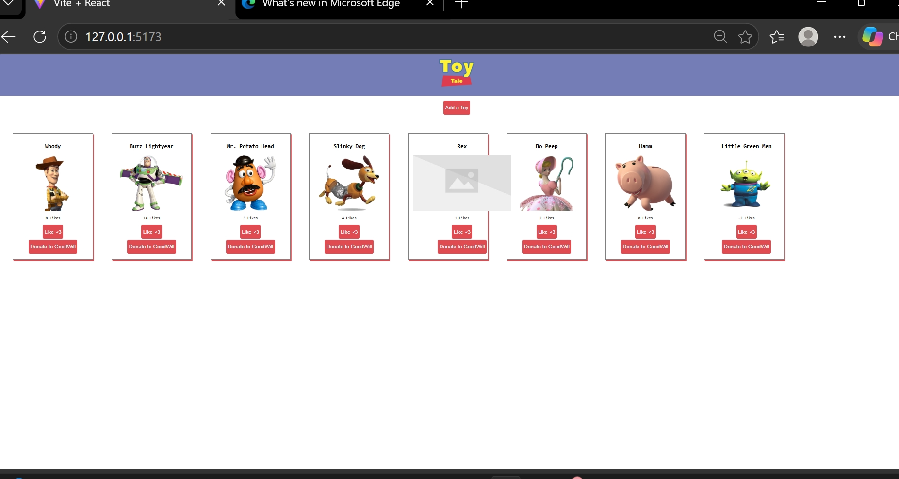

# Toy Tales

A React app for managing a toy collection. It connects to a json-server back end using GET, POST, PATCH and DELETE requests.

## Setup

All the information about the toys is in the `db.json` file. We use `json-server` to create a RESTful API for our database.

1. Run `npm install` to install the dependencies.
2. Run `npm run server` to start `json-server` on `http://localhost:3001`.
3. In another terminal, run `npm run dev` to start the React app at `http://localhost:5173`.
4. In another terminal, run `npm run test` to run the test suite.

## Features

- **View toys:** all toys load from the server when the page opens (GET)
- **Add a toy:** submit the form to create a toy with 0 likes (POST)
- **Like a toy:** increases its likes by 1 (PATCH)
- **Donate a toy:** removes it from the page and the server (DELETE)

## How it works

State lives in `App` and flows down to the other components as props. After each successful fetch, the child components call a callback prop so `App` can update its state and the page re-renders.

## Screenshot

